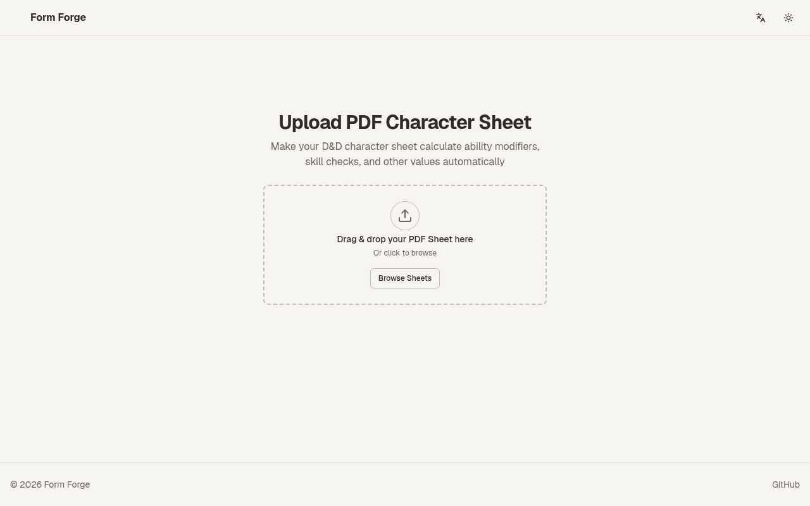
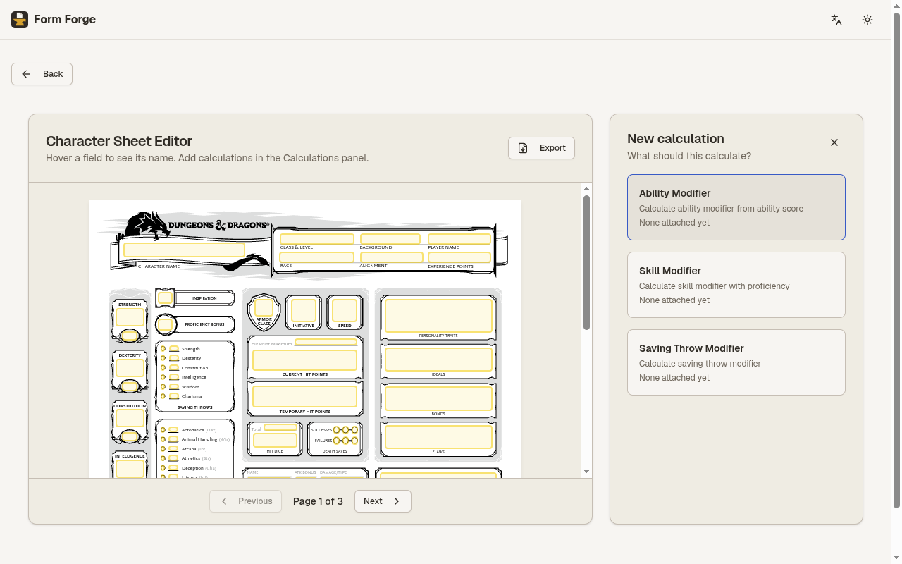
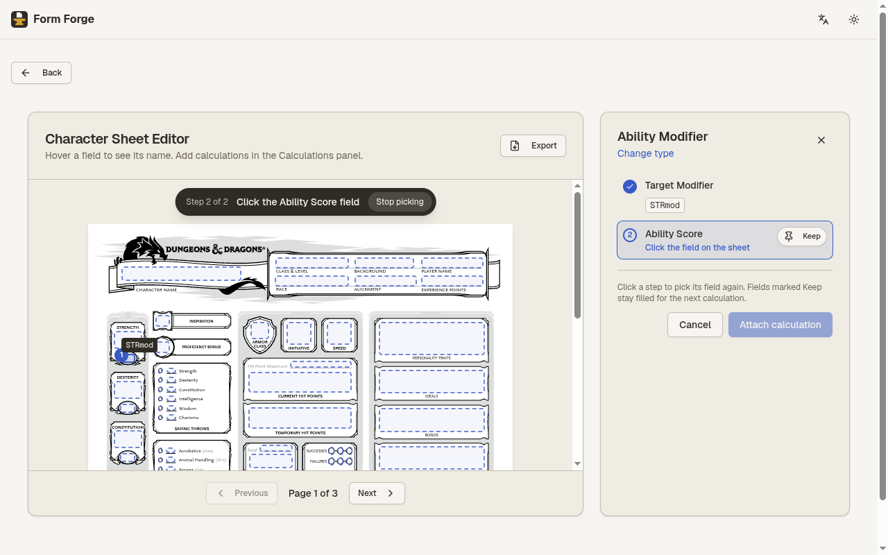
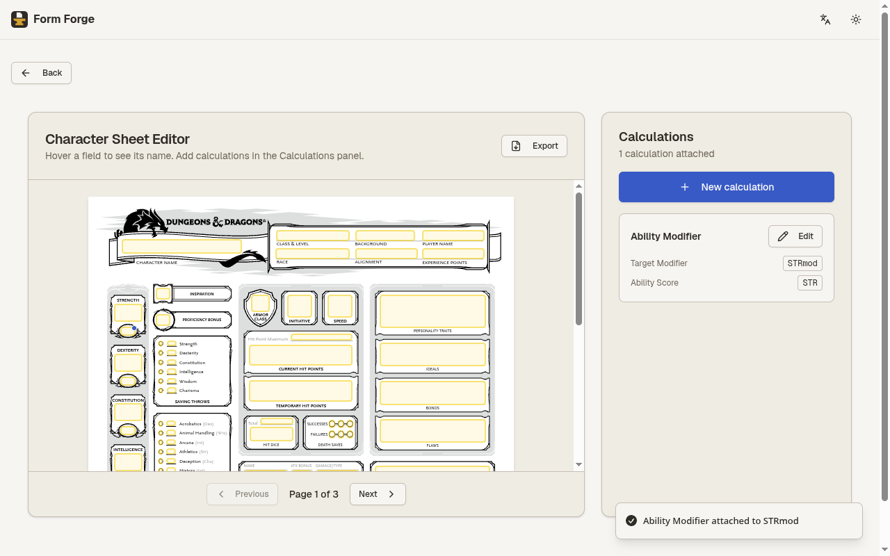

# Using Form Forge

A D&D character sheet is full of numbers that depend on other numbers. Your
Strength modifier comes from your Strength score. Your saving throws and skill
checks build on those modifiers and your proficiency bonus. Normally you work
all of that out by hand and redo it every time something changes.

Form Forge sets up those sums once and bakes them into your PDF. After that,
you type in a value like your Strength score and the sheet fills in the
results for you. No math, no scripting.

<video autoplay loop muted playsinline controls width="100%">
  <source src="../assets/usage/usage-flow.webm" type="video/webm">
</video>

## What "calculation" means here

A calculation is a rule that fills in one box from other boxes. For example:
your Strength modifier is always your Strength score minus 10, divided by two,
rounded down. You set that rule up once, and from then on the modifier appears
on its own whenever you enter a Strength score. You do this for each value you
want the sheet to work out: ability modifiers, saving throws, skill checks,
and so on.

Throughout this guide, a "field" is one of the boxes on the sheet you can
click into and type.

## Before you start

You need a fillable PDF character sheet: the kind where you can click into the
boxes and type. A scan or photo of a printed sheet won't work, because it has
no real boxes for Form Forge to attach calculations to. The official D&D
fillable character sheets work well.

## 1. Upload your character sheet

Open Form Forge and you land on the upload screen, headed **Upload PDF
Character Sheet**. Click **Browse Sheets** and pick your fillable PDF from the
file picker. Form Forge reads the sheet and takes you to the viewer.

## 2. Choose a calculation

The editor shows your sheet on the left and the **Calculations** panel on the
right. Every box Form Forge found has an outline. Hover a box to see its field
name: each PDF names its boxes differently, so this is how you tell them apart.

Click **New calculation** and choose what to calculate. For a Strength
modifier, choose **Ability Modifier**.

## 3. Click the fields on the sheet

The panel now lists the fields this calculation needs, one step at a time, and
a bar on the sheet tells you which one to click. The first step is always the
box where the result appears.

For an Ability Modifier:

1. Click the Strength **modifier** box (the result).
2. Click the Strength **score** box.

Each box you click gets a numbered badge that matches its step, and the next
step starts by itself. Picked the wrong box? Click that step in the panel and
click the right box. When every required step has a field, click **Attach
calculation**.

After you attach, the same calculation type starts again, so you can go
straight on to Dexterity, Constitution, and the rest. Click **Done** when you
have finished.

!!! tip "Fill a field once, keep it for the rest"
    Some fields are the same for every calculation of a type, like your
    proficiency bonus for every skill. Click **Keep** on that step and Form
    Forge fills it in for the next calculation of that type too.

## 4. Download your sheet

Click **Export**. Form Forge hands back your character sheet with the
calculation built in.

!!! tip "Open it in the right reader"
    Open the exported PDF in a reader that runs form calculations, such as
    Adobe Acrobat Reader. Type a Strength score and watch the modifier fill
    itself in. Some phone and in-browser previewers skip these calculations,
    so if the numbers don't update, try Acrobat Reader.

## Change a calculation

Each attached calculation has an **Edit** button in the panel. You can also
click a box with a calculation on the sheet; those boxes have a small blue dot.
Click a step to choose a different field, then click **Save changes**. The
result box stays the same while you edit.

If you attach a new calculation to a box that already has one, the new one
replaces it. The panel warns you before you attach.

## Add more calculations

Saving throws and skill checks work the same way, with a few more parts to
fill in. See [Saving throws & skill checks](calculations.md) for those, and
the [calculation reference](../reference/index.md) for every type and the
fields it needs.
